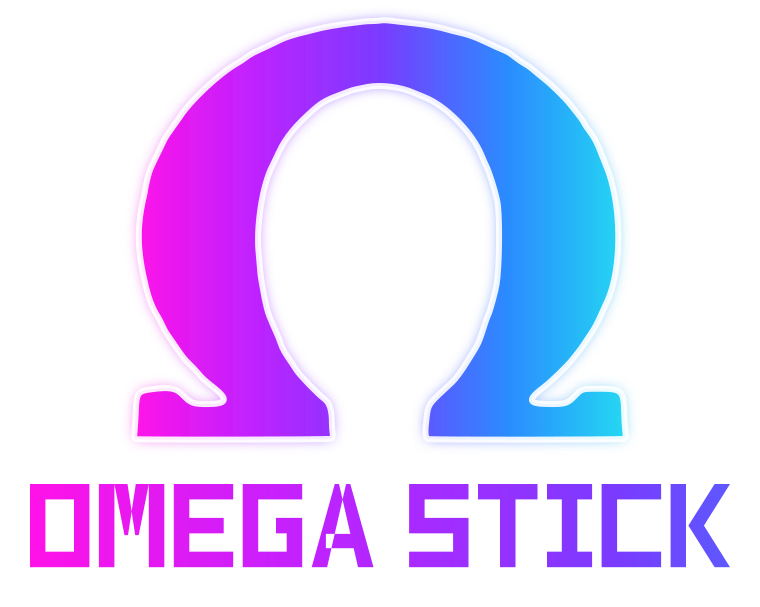

# Omega Stick



**A low-force joystick for accessible computer control and gaming.** 

[](https://github.com/ATDev-Inc/omega-stick/actions/workflows/package_main.yml)
[](https://github.com/ATDev-Inc/omega-stick/actions/workflows/static_analysis.yml)
[](https://github.com/ATDev-Inc/omega-stick/actions/workflows/host_tests.yml)
[](https://github.com/ATDev-Inc/omega-stick/actions/workflows/web_tests.yml)
[](https://github.com/ATDev-Inc/omega-stick/actions/workflows/fuzz.yml)
[](./LICENSE)

This repository holds the required firmware. There are no additional drivers or software needed aside from the web-based interface.

## Contents
- [The gap](#the-gap)
- [Project status](#project-status)
  - [What works today](#what-works-today)
- [Documentation](#documentation)
- [Firmware updates and versioning](#firmware-updates-and-versioning)
- [Hardware](#hardware)
- [Getting started](#getting-started)
  - [Hardware Assembly](#hardware-assembly)
  - [Firmware: First Flash](#firmware-first-flash)
  - [Firmware: Updates](#firmware-updates)
  - [Calibration console](#calibration-console)
  - [Expected output](#expected-output)
  - [Input modes](#input-modes)
- [Developer Notes](#developer-notes)
  - [Building from source](#building-from-source)
  - [Build options](#build-options)
  - [Running the host tests](#running-the-host-tests)
- [Repository layout](#repository-layout)
- [Contributing](#contributing)
- [Getting help](#getting-help)
- [License](#license)
- [Acknowledgements](#acknowledgements)

## The gap

The force required to move conventional joysticks is typically well over 100 grams. For someone with limited strength, reduced range of motion, tremor, or fatigue, that resistance results in an unusable design. 

Several sub-10 gram sticks already ship. They are closed, mostly dealer-gated, and often unpriced or out of stock.
The gap is the combination of low force with an open design, a plain USB HID interface, a published, transparent price, and a published method for measuring the force
claim. See [docs/PRD.md](docs/PRD.md).

We built Omega Stick to fill this gap. It uses a
contactless 3-axis Hall-effect sensor (TI TMAG5273) that measures the
position of a small magnet as well as using magnetic centering. This stick is configurable, able to increase actuation force via incorporating additional magnets. See D12 in [docs/decisions.md](docs/decisions.md).


## Project status

**Early development.** Releases are 0.x and the interfaces are not stable yet.
The latest is on the
[releases page](https://github.com/ATDev-Inc/omega-stick/releases/latest).
For component-level detail and known issues, see [docs/status.md](docs/status.md).

### What works today

- **Sensor driver and fault handling**
- **Mouse mode with nudge click option**
- **Browser calibration console**
- **Firmware updates over USB**
- **Tests in CI**

Experimental: **XAC (Xbox Adaptive Controller) gamepad mode** is implemented but not yet verified on real Xbox Adaptive Controller hardware. See [docs/status.md](docs/status.md).

Not implemented yet: response curves, per-axis inversion and gain, tremor
filtering, profiles, nudge click directional configuration, hover click option, and a status LED.

If you are looking for somewhere to help, those are the open areas. See
[CONTRIBUTING.md](./CONTRIBUTING.md).

## Documentation

Product and planning documents live in [docs/](docs/):

| Document | Contents |
| --- | --- |
| [PRD.md](docs/PRD.md) | What v1 is, who it is for, scope, and success metrics |
| [requirements.md](docs/requirements.md) | Functional and non-functional specifications |
| [decisions.md](docs/decisions.md) | Product decisions with rationale, and what is still open |
| [compliance.md](docs/compliance.md) | What the project may and may not claim about itself |
| [status.md](docs/status.md) | Current working status |
| [ROADMAP.md](ROADMAP.md) | Planned milestones, in order, and the open decisions behind them |
| [TODO.md](TODO.md) | The maintainers' working task list |
| [firmware-updates.md](docs/firmware-updates.md) | USB firmware updates, rollback, and versioning |
| [CHANGELOG.md](CHANGELOG.md) | What changed in each release |
| [research/](docs/research/) | Background research |
| [assets/logo/](assets/logo/) | Brand marks, wordmark, the animated hero scene, and usage notes |

Research documents are point-in-time snapshots and are not maintained.

## Firmware updates and versioning

A new board is flashed once, from the browser at the
[flash page](https://atdev-inc.github.io/omega-stick/flash.html) after which it must be calibrated via the console.

After that, firmware is updated over USB from the
calibration console:
<https://atdev-inc.github.io/omega-stick/console/>. Connect via WebUSB or Web Serial and
choose or drag in the app image (`build/omega_stick.bin`, or a release's
`omega_stick-X.Y.Z.bin`) in the "Firmware update" section. The page checks the
file, shows what is running and what will replace it, and reconnects by itself
afterwards. 

First flash erases any saved configuration. Additional updates via the console preserve it.

**Please paste the
console's Copy line in bug reports.**

Details are in
[docs/firmware-updates.md](docs/firmware-updates.md).

## Hardware

The firmware currently targets:

| Part | Notes |
| --- | --- |
| MCU | ESP32-S3 QtPy|
| Sensor | TI TMAG5273 3-axis Hall-effect sensor|
| Bus | Qwiic / STEMMA QT I2C |
| Host link | USB-C|

**Never plug or unplug the Qwiic cable while the
board is powered.** Unplug USB to power off.

STL files for the printed parts (joystick, magnet and sensor holders, sockets,
topper) and their editable Fusion 360 source (`omega_stick.f3d`) are in
[models/](models/). The PCB and wiring are not part of this repository. If you want to build one, open a
[discussion](https://github.com/ATDev-Inc/omega-stick/discussions) or an issue
and we will point you at what exists.

## Getting started

### Hardware Assembly

| Part | Notes | Purchase Links | Typical Cost |
| --- | --- | --- | --- |
| MCU | ESP32-S3 QtPy, configured via the ESP++ `qtpy` board support | [This one from Adafruit](https://www.digikey.com/en/products/detail/adafruit-industries-llc/5700/21283799) or [This one](https://www.digikey.com/en/products/detail/adafruit-industries-llc/5426/21283802) on Digikey| $12.50 |
| Sensor | TI TMAG5273 3-axis Hall-effect sensor| [Digikey](https://www.digikey.com/en/products/detail/adafruit-industries-llc/6490/29698502) or [Adafruit](https://www.adafruit.com/product/6490) | $5.95 |
| Bus | Qwiic / STEMMA QT I2C | [Digikey](https://www.digikey.com/en/products/detail/adafruit-industries-llc/4399/10824268) | $0.95 |
| Host link | USB-C to USB (**Check your cable**! It must allow for data transmission, not just power!) | |

**Total**: ~$20.00 (excluding shipping)

3D printable models are found in [models](models/).

Assembly steps are not written yet.

### Firmware: First Flash

Visit https://atdev-inc.github.io/omega-stick/flash.html and follow the site's instructions.

### Firmware: Updates
1. Visit https://atdev-inc.github.io/omega-stick/console/
2. Connect via WebUSB or Web Serial. No button press is needed.
3. In the "Firmware update" section, select "Check for latest firmware" or
choose `omega_stick.bin`.
4. Confirm the update and wait for the page to reconnect and report the result.

A blank board, or a stick that will not connect to the console, needs a first
flash or recovery instead, which does use `BOOT`. See the
[flash page](https://atdev-inc.github.io/omega-stick/flash.html) and
[docs/firmware-updates.md](docs/firmware-updates.md#first-flash-and-recovery).


### Calibration console

https://atdev-inc.github.io/omega-stick/console/

A browser page for viewing and tuning the stick's calibration and settings
over USB. Open it from disk in Chrome or Edge (a Chromium-based browser is required) and connect with WebUSB or Web
Serial. See the [omega_calibration README](components/omega_calibration/README.md)
for details.

Via the console, you can:

- view live calibration and settings and make manual adjustments
- switch between mouse and XAC mode
- run the full center and range calibration
- save the current settings to flash

No stick in hand? Run the desktop simulator (`omega_sim`; build, run and
troubleshooting steps are in [sim/README.md](sim/README.md)).

### Expected output

With a TMAG5273 connected on the Qwiic bus, the serial monitor shows the sensor
coming up and then the calibration step:

```
Initializing TMAG5273...
TMAG5273 initialized successfully!
```

A board with a usable saved calibration prints `Loaded existing calibration.`
A board without one prints `No usable calibration` and is not moveable until calibration is completed. 

If you see `ERROR: TMAG5273 initialization failed`, check the Qwiic cable is plugged in all the way (with USB
unplugged).

### Input modes

The stick boots as a mouse by default. It also has the option to present as an Xbox Adaptive Controller style gamepad (XAC). The mode is a saved setting, and switching it restarts the device to apply it.

**Note:** Nudge clicks are off on a fresh board; turn them on in the console.

**Nudge click directions:**
- Away from user: Left click
- Towards User: Scroll down
- Left of user: Scroll up
- Right of user: Right click

## Developer Notes

### Building from source

The firmware builds with ESP-IDF v6.0 (the version CI builds with). Setup and
build steps are in [CONTRIBUTING.md](CONTRIBUTING.md#development-environment).
A full `idf.py flash` replaces saved calibration; `idf.py app-flash` keeps it.

### Build options

`idf.py menuconfig`, under "Omega Stick Configuration", has two options.
`OMEGA_STICK_BOOT_FLASH_WINDOW_S` (default 0, range 0 to 60) is how many
seconds the firmware waits at boot before starting USB. While it waits, the
built-in USB Serial/JTAG still owns the port, so `idf.py flash` works without
holding BOOT. As a developer, set it locally in `idf.py menuconfig` (your
`sdkconfig` is gitignored); leave it at 0 for anything users run.
`OMEGA_STICK_OTA` (default on) builds in firmware updates over USB; the
`sdkconfig.no_ota` defaults fragment turns it off. See
[docs/firmware-updates.md](docs/firmware-updates.md). The flash layout is in
[partitions.csv](partitions.csv) and assumes the 8 MB QT Py ESP32-S3.

### Running the host tests

Most of the firmware logic has unit tests that run on your desktop without a
board or ESP-IDF: the calibration maths and persistence, the console protocol,
the TMAG5273 driver, the HID reports and descriptors, and the control loop.
They need CMake and a C++20 compiler:

```console
cmake -S tests/host -B build-host
cmake --build build-host
ctest --test-dir build-host --output-on-failure
```

The calibration console's protocol code has its own tests under Node:

```console
node --test "tests/web/*.test.js"
```

See [tests/host/README.md](tests/host/README.md) and
[tests/web/README.md](tests/web/README.md) for what they cover. CI runs both,
plus a short fuzzing pass over the frame parser ([tests/fuzz](tests/fuzz/README.md)).

## Repository layout

The short version is below. [DIRECTORY.md](DIRECTORY.md) maps every directory and the files that matter in each.

```
main/                     application entry point, IDF component manifest, Kconfig options
components/tmag5273/      TMAG5273 Hall-effect sensor driver
components/omega_calibration/
                          calibration, persisted settings, the USB console protocol,
                          and the web calibration console (web/)
components/omega_control/ the control loop's logic (nudge clicks, drift, recalibration
                          hand-off), pure and host-tested; main.cpp wires hardware to it
components/hid-rp-mouse/  HID mouse report descriptor and input report
components/xac/           Xbox Adaptive Controller gamepad report
tests/host/               desktop unit tests for the components above (no hardware needed)
tests/web/                Node tests for the console's protocol code
tests/protocol/           golden frames generated by the C++ service, checked by both suites
site/                     GitHub Pages landing page, first-flash page and console service worker, published with each full release
scripts/                  release_feed.mjs, which builds the release feed for the Pages site
tests/fuzz/               libFuzzer harness and seed corpus for the frame parser
tests/e2e/                end-to-end check of the console against the simulator (CI)
sim/                      omega_sim, a desktop simulator of the firmware for testing without hardware
cmake/                    shared CMake setup for the host tests and the simulator
models/                   STL files and Fusion 360 source for the printed parts (joystick, magnet
                          and sensor holders, QT Py holder, sockets, topper), CERN-OHL-P-2.0
docs/                     product, requirements, decisions, and research documents
assets/logo/              brand assets
.github/workflows/        build, packaging and Pages publishing, size delta, static analysis, security scans, host, web, end-to-end and fuzz test CI
partitions.csv            flash partition table (nvs, otadata, phy_init, two OTA app slots, littlefs, coredump)
sdkconfig.defaults        project-wide ESP-IDF configuration defaults
```

## Contributing

Contributions are welcome, and not only code.

- **Are you a user of assistive technology?** Feedback about how the stick
  actually performs for you is the most valuable input this project can get. You
  do not need to know anything about programming or electronics to file
  [accessibility
  feedback](https://github.com/ATDev-Inc/omega-stick/issues/new/choose).
- **Are you a developer?** See [CONTRIBUTING.md](./CONTRIBUTING.md) for
  environment setup, code style, and the pull request process.

Everyone participating in this project is expected to follow the [Code of
Conduct](./CODE_OF_CONDUCT.md). To report a security issue, see
[SECURITY.md](./SECURITY.md).

## Getting help

Questions go to [GitHub Discussions](https://github.com/ATDev-Inc/omega-stick/discussions),
bugs and requests to the [issue forms](https://github.com/ATDev-Inc/omega-stick/issues/new/choose),
and security reports privately as described in [SECURITY.md](SECURITY.md). See
[SUPPORT.md](SUPPORT.md) for what this project can and cannot help with.

## License

Released under the [MIT License](./LICENSE). The 3D models and CAD source in
[models/](models/) are released under the
[CERN Open Hardware Licence Version 2, Permissive](models/LICENSE)
(CERN-OHL-P-2.0). The firmware image also contains
third-party code under its own licenses (MIT, Apache-2.0, BSD-3-Clause,
MPL-2.0 and BSL-1.0), plus the libraries ESP-IDF itself bundles; see
[THIRD_PARTY_NOTICES.md](THIRD_PARTY_NOTICES.md).

## Acknowledgements

Built on [ESP++ (espp)](https://github.com/esp-cpp/espp) and started from the
[esp-cpp/template](https://github.com/esp-cpp/template) project template, both
by [esp-cpp](https://github.com/esp-cpp).
